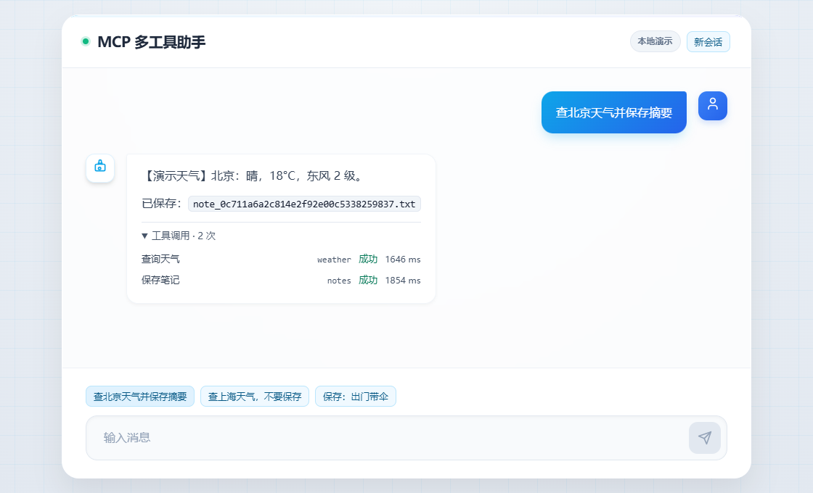
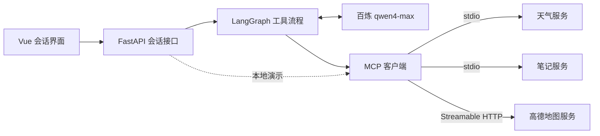

# MCP 多工具助手

MCP 多工具助手通过 LangGraph ReAct 和通义千问编排天气查询、本地笔记与高德路线导航。用户可以用自然语言发起多步任务，页面展示每次工具调用的顺序、状态和耗时。



## 工具如何协作



- **多服务统一发现**。后端通过同一个 MCP 客户端接口管理本地天气、笔记服务与可选的远程高德服务。服务内部新增工具可通过发现过程提供参数定义，编排复用同一套执行逻辑。连接出错时，其他服务可以继续使用。
- **顺序与写入控制**。用户明确要求时才允许保存。先查再存的请求要等对应天气或路线结果成功。同一次请求最多尝试写入一次，文件保存在 `output/`。
- **多步推理**。模型以非流式方式返回完整工具参数，每轮执行一个工具，再把结果交回模型，直到给出答复或达到工具轮次上限。
- **会话隔离**。每个会话使用独立的 `thread_id`，同一会话中的请求按顺序处理。服务重启后会话清空，笔记文件留在磁盘。

## 本地运行

验证环境为 Windows、Python 3.12 和 Node 24。在仓库根目录打开 PowerShell。

```powershell
py -3.12 -m venv .venv
.\.venv\Scripts\python.exe -m pip install -r requirements.txt
Copy-Item .env.example .env
.\.venv\Scripts\python.exe -m uvicorn assistant_app.server:app --host 127.0.0.1 --port 8000
```

已有 `.env` 时跳过复制命令。另开一个终端，在仓库根目录启动前端。

```powershell
Set-Location frontend
npm ci
npm run dev -- --host 127.0.0.1
```

打开 [本地演示页面](http://127.0.0.1:5173/)。默认使用固定天气数据，支持北京、上海和杭州。可试「查北京天气并保存摘要」「查上海天气，不要保存」或「保存：出门带伞」。

### 百炼模型模式

在本地 `.env` 设置 `DASHSCOPE_API_KEY`，再重启后端。默认模型为 `qwen4-max`，接口为北京地域。保留 `ASSISTANT_MODE=auto` 时，有凭据使用模型调用，无凭据使用本地演示。设为 `demo` 可固定使用本地演示。浏览器只连接本地后端。

### 实时天气与高德导航

- 异步实时天气使用 OpenWeather。设置 `OPENWEATHER_API_KEY` 和 `MCP_WEATHER_MODE=live` 后重启。演示数据保持为默认设置。
- 在百炼模型模式下设置 `AMAP_MAPS_API_KEY` 后重启，后端会发现高德地图服务中的地理编码、地点搜索、步行、驾车、公交及导航工具。连接成功后可在页面试「查北京市天安门到王府井的步行路线」，也可要求提供高德导航链接。[高德 MCP 接入说明](https://developer.amap.com/api/mcp-server/gettingstarted)

## 验证结果

以下是本地演示的实际运行结果。浏览器测试使用固定天气数据，两个工具通过 MCP 子进程实际执行。

| 场景 | 结果 |
| --- | --- |
| 浏览器查询北京天气并保存摘要 | 两个工具按顺序成功。天气查询 1.65 秒、笔记保存 1.85 秒，从点击到页面展示约 3.73 秒 |
| 确认笔记落盘 | 打开生成的文件，内容包含北京演示天气 |
| 只查询天气 | 调用了天气工具，输出目录没有新笔记 |
| 两个会话并行保存 | 会话 ID 和文件名均不同，回顾上一条消息时内容各自独立 |
| 天气服务启动失败 | 天气查询告知不可用，手写笔记仍能保存 |
| 自动化回归 | 11 项通过，覆盖工具顺序、写入限制、会话隔离、服务故障、非流式模型请求、天气凭据校验和中文城市名 |
| 高德路线与导航 | 使用模拟 HTTP 响应验证 Streamable HTTP 下的工具发现、两次地点查询、步行路线和导航链接 |

使用实际服务完成两条联调，耗时从提交聊天请求起计。

| 场景 | 联调结果 | 单次耗时 |
| --- | --- | --- |
| 北京实时天气并保存笔记 | `qwen4-max` 先调用 OpenWeather，再调用文件工具。核对了天气里的温度字段和临时笔记里的城市及温度单位 | 10.69 秒 |
| 天安门到王府井的步行路线和导航链接 | `qwen4-max` 依次调用两次高德地理编码、步行路径规划、导航链接工具。核对了路线数据和链接格式 | 18.91 秒 |

运行回归测试及前端构建。

```powershell
.\.venv\Scripts\python.exe -m unittest discover -s tests -v
Set-Location frontend
npm run build
```

完成百炼配置后，在仓库根目录用以下命令联调一次。它会使用真实模型和演示天气，并核对工具顺序及临时笔记内容。

```powershell
.\.venv\Scripts\python.exe -m tests.live_qwen_smoke
```

配置对应的服务凭据后，可分别验证 OpenWeather 实时天气和高德路线导航。

```powershell
.\.venv\Scripts\python.exe -m tests.live_qwen_smoke --live-weather
.\.venv\Scripts\python.exe -m tests.live_qwen_smoke --amap
```
